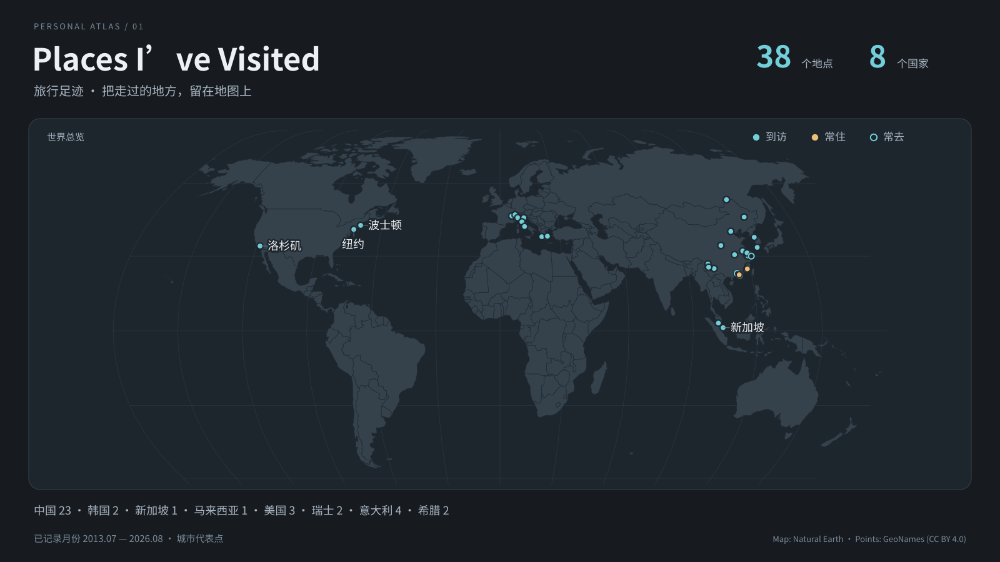

# 旅行足迹 · Travel Footprints

交互地图首次打开默认英文。右上角的 **EN / 中文** 按钮可切换中英文并记住选择；城市名、国家地区、月份、时间线、统计和操作提示会一起切换，当前地图位置和筛选保持不变。中英文搜索始终同时可用。翻译文案在 `site/i18n.js`，新增城市时请同时填写 `nameEn`，并补充该文件中的英文地区名。静态 SVG 封面仍沿用原版本。

**[打开交互地图 →](https://nacr05.github.io/travel-footprints-site/)**

一张慢慢填满的世界地图。深色灰阶底图、细小的蓝色光点、默认收起的侧栏，记录走过的城市与到访月份。当前示例是作者已确认公开的 38 座城市、8 个国家。

[](https://nacr05.github.io/travel-footprints-site/)

## 当前功能

- 拖动、滚轮或双指缩放、缩放按钮、回到世界全图。
- 悬浮或键盘聚焦显示城市、国家和到访月份；点击查看城市详情。
- 城市列表、时间线、概览；支持中英文搜索、国家和年份筛选。
- 可收起的侧栏、深浅配色、手机底部面板。
- 支持多次到访、常住和常去记录，以及可选照片和游记链接。
- 城市详情使用 hash 路由，可直接分享链接，例如 [吉隆坡](https://nacr05.github.io/travel-footprints-site/#/city/kuala-lumpur)。

所有者可以在城市相册中点击「添加照片」或「管理照片」，用 GitHub 登录后选择或拖入照片、填写月份和说明，直接保存到仓库。保存成功后当前相册立即更新，公开网站在后台发布，界面自动确认进度；期间可以继续浏览和编辑。「管理照片」支持选择月份、预览并确认移除已保存的照片；共用图片会保留，仓库历史不清除。实际接入证据、操作步骤及限制见[地图内照片管理指南](docs/in-map-upload.md)。排序和修改已保存说明仍可使用 Pages CMS，步骤见[相册管理指南](docs/photo-cms.md)。每个「城市 + 月份」相册最多 24 张，地图内每批最多 5 张。

底图只有国家轮廓，不包含街道、建筑或实时地点搜索。前端组件、底图和城市数据随项目保存，浏览地图不需要地图 API key 或后端账户；只有保存照片需要所有者登录。

## 本地开发

安装 Node.js 22 或更新的受支持版本，然后：

```sh
git clone https://github.com/NaCr05/travel-footprints-site.git
cd travel-footprints-site
npm start
```

打开 [本地预览](http://127.0.0.1:4173/)。所有运行组件已随仓库保存，无需 `npm install`。请通过本地服务打开页面，直接双击 HTML 会受到浏览器文件读取限制。

```sh
npm run check             # 生成 SVG，并检查数据、生成结果与交互数据逻辑
npm run build             # 只重新生成 SVG 封面和局部图
npm run export -- dist    # 导出网站到空目录 dist
```

`dist` 必须为空，避免残留旧文件。重复导出前请先确认并移走或清理自己的旧导出目录。开发预览可通过 `PORT` 修改端口，通过 `PREVIEW_BASE=/travel-footprints-site` 模拟 GitHub Pages 子路径。

## 修改城市与页面

`data/places.geojson` 是城市和到访记录的维护入口；Pages CMS 只编辑独立的 `data/photo-albums.json` 相册清单，预览和发布时自动合并。原始 Excel、整理 CSV 和清单核对资料不属于本公开项目，也不会自动更新网页。添加城市、月份、照片和游记的格式见 [编辑指南](docs/editing.md)。

| 文件 | 负责内容 |
|---|---|
| `index.html`、`site/styles.css` | 页面结构、配色与布局 |
| `site/app.js` | 地图、侧栏、详情和页面交互 |
| `site/model.js` | 搜索筛选、时间线和链接处理 |
| `site/projection.js` | 等距圆柱显示与地图渲染坐标的转换 |
| `data/places.geojson` | 已公开的城市、国家、月份和分类 |
| `.pages.yml`、`data/photo-albums.json`、`photos/` | 网页相册表单、照片关联与上传文件 |
| `data/basemaps/`、`vendor/` | 固定版本底图、组件与许可证 |
| `scripts/` | 预览、SVG 生成、检查与网站导出 |
| `.github/workflows/pages.yml` | 检查后发布 GitHub Pages |

原始经纬度为 WGS84；等距圆柱式显示只在渲染入口进行转换。接入街道瓦片或新的底图之前，需要统一投影。

## 网站发布

本仓库同时维护源码和网站。更新 `main` 后，GitHub Actions 运行检查、导出网页并发布到固定网址：

**[nacr05.github.io/travel-footprints-site](https://nacr05.github.io/travel-footprints-site/)**

拉取请求只运行检查，不发布；只有检查通过的 `main` 版本可以部署。也可以从 Actions 手动运行发布。不要再维护或上传 `website.zip`。源码中的 `package.json` 设置 `private: true` 只用于防止误发布 npm 包，不会改变 GitHub 仓库的公开状态。

## 数据与许可

仓库里的城市、访问月份、分类、照片和游记均可被公开访问。只提交准备公开的内容；私人表格、备份和凭据应留在仓库之外。城市坐标是代表点，不表示住址、酒店或完整旅行路线。未知月份保持为空，不推断行程顺序。

地图轮廓来自 Natural Earth（公共领域），坐标来自 GeoNames（CC BY 4.0），MapLibre GL JS 为 BSD-3-Clause，D3 为 ISC。完整署名与许可见 [THIRD_PARTY.md](THIRD_PARTY.md)，资产来源见 [data/sources.json](data/sources.json)。

**本项目目前公开源码，尚未选择自有代码的开源许可证。** 第三方组件遵循各自许可证，作者的个人旅行记录也应与未来的代码许可分开处理。后续计划考虑通用配置、独立的示例数据和许可证选择；这些尚未作为已完成的通用工具发布。
